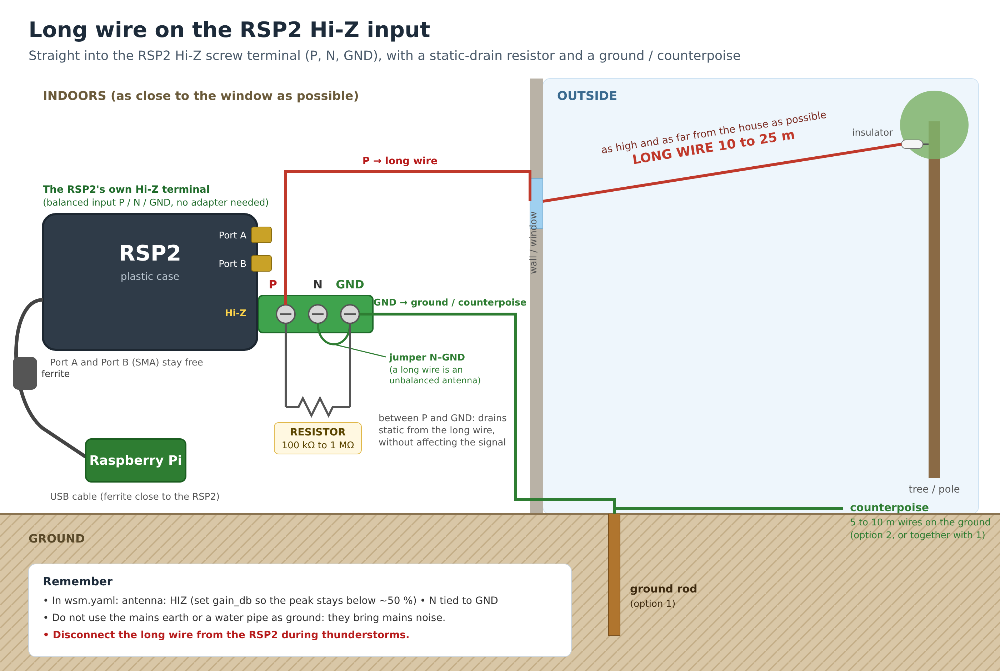

# Hardware notes

What this station runs on, and what was learned the hard way while building it.

## Raspberry Pi

| Model | Result |
|---|---|
| **Raspberry Pi 3B+** | runs WSM together with an ADS-B receiver (readsb + four feeders with MLAT) at 100 % slot coverage |
| Raspberry Pi 3B | enough CPU for WSM alone, but its power input lost voltage after hours of load (see below) |
| Raspberry Pi 4 / 5 | more headroom; expected to work (USB-C supply) |

The heavy part is not WSM itself but the **SDRplay API service** (`sdrplay_apiService`): the RSP2 always streams at least
2 MS/s over USB and the API decimates it to 62.5 kS/s on the CPU, which takes about 85 % of one core of a Pi 3B+ at 1.2 GHz.
If the CPU slows down (heat or under-voltage) the API falls behind and drops samples without any error message; WSM then
reports `slot covered NN %` and the **samples are being lost** alert. Hence:

- keep the CPU at full speed: good power, good cooling;
- give `sdrplay.service` a higher priority than other busy programs (`Nice=-10`, see [INSTALL.md](INSTALL.md));
- a Pi 3B+ throttles from 1.4 to 1.2 GHz above 60 °C by design; that is still enough.

## Power supply

The single biggest source of trouble. Symptoms of a weak supply or cable: `vcgencmd get_throttled` showing `0x50005`
(under-voltage now), the CPU stuck at 600 MHz, slots with missing samples, the **under-voltage** alert.

- Use the **official Raspberry Pi supply** (5.1 V, with its own cable). A 5.0 V phone charger or a thin/long cable drops below
  the 4.63 V limit under load.
- Every USB device takes current from the same supply: the RSP2 and an RTL-SDR dongle together are a heavy load for a Pi 3.
  A **powered USB hub** for the radios takes that load off the Pi (keep the hub's supply away from the HF antenna and use
  ferrites: switching supplies can add noise on HF).
- A supply can look fine for an hour and fail after several hours of continuous load. WSM's System card and the power alert
  watch this all the time.

## Cooling

Heatsinks alone are not enough without air flow. On the Pi 3B+ they go on the **SoC** (the large Broadcom chip) and on the
**USB/Ethernet controller** (Microchip LAN7515); not on the Wi-Fi shield. Best options: an aluminium "armour" case with fans
(the case itself is the heatsink) or a 5 V fan blowing over the heatsinks. Measured here: about 49–53 °C with a fan,
56–66 °C without one, depending on the load and the room.

## RSP2 and antennas

The RSP2 has three inputs: **Port A** and **Port B** (SMA, 50 Ω) and **Hi-Z** (a 3-way screw terminal P / N / GND, about
1 kΩ, 1 kHz–30 MHz). For a multi-band HF receiving station, a **long wire on the Hi-Z input** is simple and effective:

- **P** – the long wire (10–25 m, outdoors, as high and as far from the house as possible).
- **N** – tied to **GND** (a long wire is an unbalanced antenna; this is SDRplay's recommended connection).
- **GND** – a ground rod and/or counterpoise wires. Not the mains earth or a water pipe: they bring noise.
- A **100 kΩ – 1 MΩ resistor between P and GND** drains static charge from the wire without affecting the signal.
- A ferrite on the RSP2's USB cable keeps computer noise out.
- In `wsm.yaml`: `antenna: HIZ`, and adjust `gain_db` (per band if needed) so the input peak stays below about 50 %.
- **Disconnect the wire during thunderstorms.**

The RSP2's reference oscillator moves with temperature (about 1 ppm, 15–20 Hz at 14 MHz, was seen when a fan was switched
off). It does not affect decoding, but keep the RSP2 out of direct air flow if you compare frequencies over time.

## Test transmitter

A GPS-timed WSPR beacon a few metres from the antenna is the best reference to check the whole chain and to calibrate
`clock_offset_s`. Power it from a battery or a linear supply: a phone charger put 60 Hz sidebands on the signal here (copies of
the signal every 60 Hz, sometimes decoded instead of the main one). With `store_own_spots: no` its spots are not stored, but
their SNR / DT / drift are logged.
